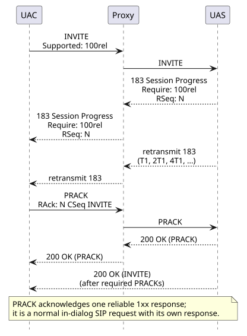
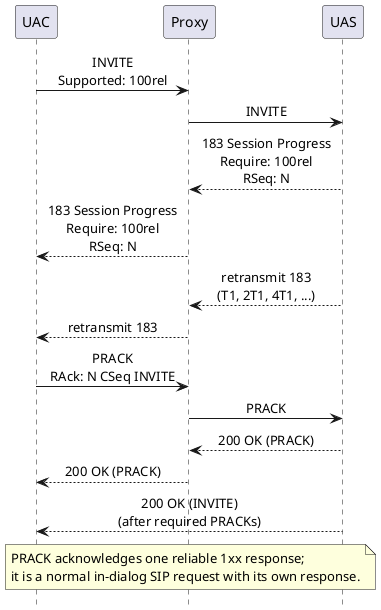
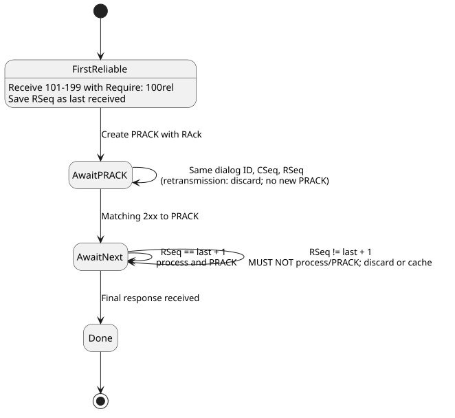
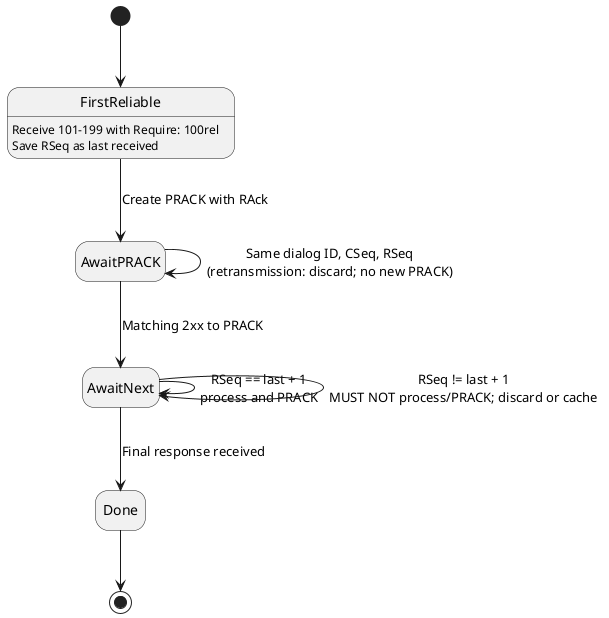
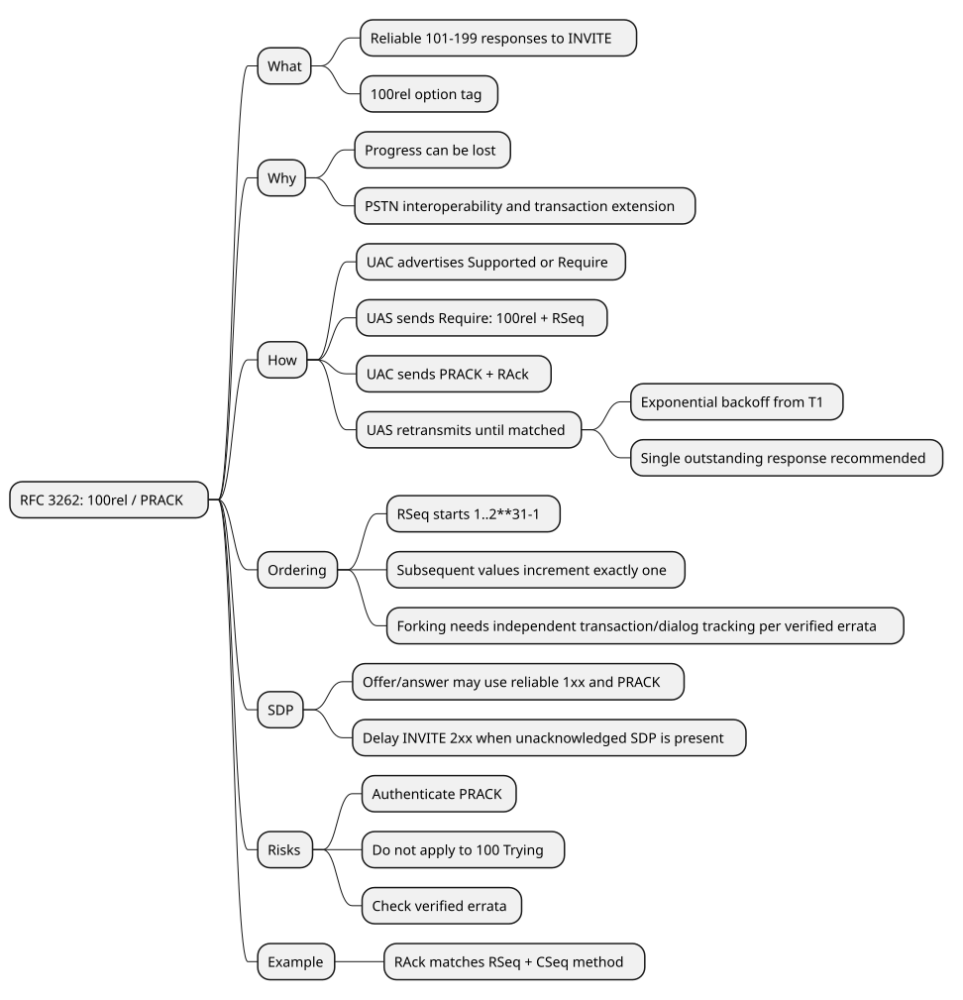
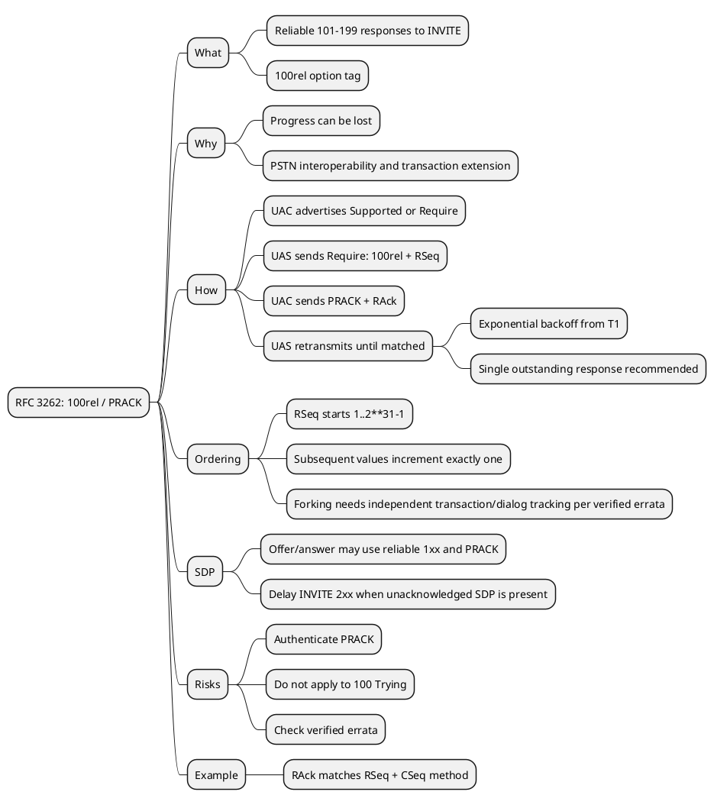

# RFC 3262 — Reliability of Provisional Responses in Session Initiation Protocol (SIP): Visual Explanation

> **Reader lens:** general software engineer, new to SIP · **Goal:** learn the mechanism and implement the core behavior · **Depth:** practitioner

> **Artifact status:** Complete

## What

**In one sentence:** RFC 3262 adds end-to-end reliability for SIP provisional responses 101–199 by defining the `100rel` option tag, the `RSeq`/`RAck` headers, and the `PRACK` method.

SIP final responses are reliable, but RFC 3261 provisional responses were not. RFC 3262 lets a UAS retransmit a provisional response with exponential backoff until the UAC acknowledges that specific response with PRACK. The same exchange can carry SDP offer/answer information before the INVITE receives its final response.

| Status check | Verified value |
| --- | --- |
| Category / status | Proposed Standard; IETF Standards Track |
| Current? | Yes as an RFC; verified errata apply |
| Updates / obsoletes | Obsoletes RFC 2543 |
| Updated / obsoleted by | None listed on the RFC Editor info page |
| Publication date | RFC header: June 2002; RFC Editor metadata: July 2002 |
| Errata | 6 verified technical errata; 2 rejected technical reports; no held or reported items shown on the queried errata page |

## Why

| Problem | Consequence if unsolved |
| --- | --- |
| Progress responses can be lost while an INVITE is still processing | The caller cannot reliably learn early call state or media parameters. |
| Long-running INVITE transactions need periodic progress | Proxies may time out the transaction, especially across unreliable paths. |
| PSTN interworking needs reliable early signaling | Gateways cannot depend on an unacknowledged 1xx response. |

**Non-goals:** RFC 3262 does not make `100 (Trying)` reliable; it is hop-by-hop, while this mechanism is end-to-end. It also does not make PRACK a special transport primitive: PRACK is an ordinary in-dialog SIP request with its own response.

## Concepts to know first

| Term | Plain meaning | Precise role in this RFC |
| --- | --- | --- |
| UAC | SIP client that sends a request | Receives reliable 1xx responses and sends PRACK. |
| UAS | SIP server that answers a request | Creates, retransmits, and retires reliable 1xx responses. |
| Provisional response | SIP response numbered 100–199 | Only 101–199 can use this reliability extension. |
| `100rel` | SIP option tag | Advertises support in `Supported`; requires reliable behavior in `Require`. |
| `RSeq` | Reliable-response sequence number | Appears in a reliable 1xx response. |
| `RAck` | Acknowledgment tuple | Appears in PRACK as `RSeq CSeq-number method`. |
| PRACK | Provisional Response ACKnowledgement | Acknowledges one reliable provisional response, not a cumulative range. |
| Early dialog | Dialog created by a provisional response | The UAC tracks reliable-response ordering independently for each dialog ID according to verified errata 4603/4604. |

Analogy: PRACK is like a delivery receipt for one numbered progress update. The analogy stops at transport behavior: PRACK itself travels as a normal SIP request and is acknowledged by a normal 2xx response.

## How

### Big picture



<details>
<summary>PlantUML source: rfc3262.assets/big-picture.puml</summary>



</details>

**What to notice:**

- `RSeq` identifies the response; `RAck` copies that value plus the response's INVITE CSeq number and method [RFC §1, §7].
- The UAS retransmits independently of receiving 1xx packets; the PRACK transaction is hop-by-hop reliable through stateful proxies [RFC §1, §3].

### 1. Negotiate the capability — RFC §3 and §4

**Input → rule → output:** an INVITE declares whether `100rel` is supported or required → the UAS chooses or is compelled to use reliable 1xx → the response either enters the PRACK flow or the request is rejected.

- **Optional support:** `Supported: 100rel` means the UAC can send or receive reliable provisional responses. The UAS MAY send a non-100 reliable response.
- **Required support:** `Require: 100rel` in the INVITE means the UAS MUST send non-100 provisional responses reliably. If it cannot, it MUST reject the INVITE with `420 Bad Extension` and `Unsupported: 100rel`.
- **Forbidden case:** `100 Trying` MUST NOT be sent reliably. A UAC MUST ignore `100rel` on a 100 response.
- **Proxy boundary:** a proxy may generate a reliable provisional response only as a UAS for an initial request; it MUST NOT generate one for a request already inside a dialog (`To` has a tag). An unmatched PRACK received by such a proxy MUST be proxied [RFC §3].

### 2. Send and retransmit one reliable 1xx — RFC §3

The UAS constructs the normal provisional response, then adds:

```sip
Require: 100rel
RSeq: 988789
```

The first RSeq for a transaction MUST be in `1..2**31-1`; uniform random selection is RECOMMENDED. Each later RSeq for the same request MUST increase by exactly one and MUST NOT wrap. RSeq numbering is scoped to a transaction, so separate requests—and forked transaction branches—can use the same value; verified erratum 4600 makes the fork-independence point explicit.

The UAS passes the response to the transaction layer at `T1`, then `2*T1`, `4*T1`, and so on. Unlike INVITE 2xx retransmission, this interval does not use a `T2` cap [RFC §3]. The UAS SHOULD reject the original request with a 5xx if retransmission continues for `64*T1` without the corresponding PRACK.

The UAS MUST NOT send the second reliable provisional response until the first is acknowledged. It is RECOMMENDED to wait for each previous response before sending the next one, which provides congestion control and preserves order [RFC §1, §3].

### 3. Build, validate, and answer PRACK — RFC §3, §4, §7.2

For a reliable 1xx, the UAC MUST establish a dialog if needed and create a PRACK in that dialog. Its acknowledgment tuple is:

```sip
RSeq: 988789
CSeq: 1 INVITE

PRACK sip:bob@example.com SIP/2.0
RAck: 988789 1 INVITE
```

`RAck` is `response-number CSeq-number method`; the method name is case sensitive. The UAS matches the PRACK by dialog plus all three RAck components. A matching PRACK gets a 2xx response and removes the response from the unacknowledged list. A non-matching PRACK gets `481 Call/Transaction Does Not Exist` [RFC §3, §7.2].

The UAC MUST discard a retransmitted 1xx identified by the same dialog ID, CSeq, and RSeq, and SHOULD NOT send another PRACK for that retransmission. For subsequent responses, the UAC MUST process and acknowledge only the next expected RSeq; an unexpected value MUST NOT be processed or acknowledged. The verified errata clarify that this sequence state is maintained independently for each dialog/early dialog where applicable [Errata 4603, 4604].



<details>
<summary>PlantUML source: rfc3262.assets/uac-ordering.puml</summary>



</details>

**What to notice:**

- A retransmission is harmless once identified; it does not create a second PRACK transaction [RFC §4].
- A gap is not repaired by acknowledging the later response; the UAC waits, discards, or caches it [RFC §4; Errata 4604].

### 4. Carry SDP before the final INVITE response — RFC §5

Reliable provisional responses and PRACK expand the SIP offer/answer possibilities:

- If INVITE contains an offer, the UAS MAY return the answer in a reliable 1xx.
- If INVITE contains no offer and the first reliable response is the first reliable message back, that response MUST contain the offer; the UAC MUST put the answer in PRACK.
- If the reliable 1xx contains an answer, the UAC MAY put a new offer in PRACK; the UAS MUST put the answer in the PRACK 2xx.
- Once an offer/answer exchange is complete, the UA SHOULD establish the session even before the INVITE final response.
- If an accepted INVITE still has an unacknowledged reliable 1xx containing SDP, the UAS MUST delay the INVITE 2xx until the PRACK arrives.

## Normative requirements

| Strength | Requirement in plain language | Applies when | Source |
| --- | --- | --- | --- |
| MUST NOT | Never use this mechanism for 100 Trying. | Any 100 response | RFC §3, §4 |
| MUST | Put `Require: 100rel` and `RSeq` in every reliable provisional response. | UAS sends reliable 101–199 | RFC §3 |
| MUST | Use a first RSeq in `1..2**31-1`; later RSeq values increase exactly one and never wrap. | One request/transaction | RFC §3 |
| MUST | Create an in-dialog PRACK for a reliable provisional response. | UAC receives reliable 101–199 | RFC §4 |
| MUST | Match PRACK using dialog, RSeq, CSeq number, and method; return 2xx if matched, 481 otherwise. | UAS receives PRACK | RFC §3 |
| MUST NOT | Do not process or PRACK an out-of-order subsequent response. | UAC sees an unexpected RSeq | RFC §4; verified errata 4604 |
| SHOULD | Authenticate PRACK like any other SIP request. | All deployments | RFC §9 |
| MUST | Delay INVITE 2xx when an unacknowledged reliable 1xx carries SDP. | Offer/answer is in progress | RFC §5 |
| SHOULD | Use one outstanding reliable provisional response at a time. | Congestion/order control | RFC §1, §3 |

## Example

**What this verifies:** the `RAck` tuple correctly acknowledges the `RSeq` and the original `CSeq` method/number. It does not prove network delivery, dialog matching, authentication, or retransmission timing; those require a SIP transaction test.

**Prerequisites:** POSIX `awk` (available on macOS and Linux); no network, credentials, or third-party package is needed.

```shell
awk '
$1 == "RSeq:" { rseq = $2 }
$1 == "CSeq:" { cseq = $2; method = $3 }
$1 == "RAck:" {
  if ($2 == rseq && $3 == cseq && $4 == method) matched = 1
}
END {
  if (!matched) exit 1
  print "PASS: RAck matches RSeq and CSeq"
}' <<'SIP'
RSeq: 988789
CSeq: 1 INVITE
RAck: 988789 1 INVITE
SIP
```

**Expected evidence:**

```text
PASS: RAck matches RSeq and CSeq
```

Changing the RAck method to `invite`, or changing either number, must make the command exit non-zero and print no PASS line. The field structure comes from RFC §7.2 and the matching rule from RFC §3.

## Implementation and review checklist

- [ ] Advertise `Supported: 100rel` when the UAC supports the extension; use `Require: 100rel` only when the INVITE requires it [RFC §4].
- [ ] Reject unsupported required usage with `420` plus `Unsupported: 100rel` [RFC §3].
- [ ] Exclude `100 Trying`; accept only reliable 101–199 [RFC §3, §4].
- [ ] Track outstanding responses and retransmit from T1 with exponential backoff; stop only after a matching PRACK [RFC §3].
- [ ] Track RSeq ordering in the correct transaction/dialog scope, including forks; incorporate verified errata 4600 and 4603–4604.
- [ ] Return 2xx for a matching PRACK and 481 for an unmatched one [RFC §3].
- [ ] Handle SDP in reliable 1xx, PRACK, and PRACK 2xx; delay INVITE 2xx when required [RFC §5].
- [ ] Authenticate PRACK and protect it against injected acknowledgments that could stop retransmissions [RFC §9].
- [ ] Confirm the `100rel` option tag and `RSeq`/`RAck` headers are handled as registered; neither header has a compact form [RFC §8].

## Conclusion

1. `100rel` negotiates the capability, `RSeq` numbers one reliable 1xx, and `RAck` tells PRACK exactly which response was received.
2. Reliable provisional responses are retransmitted until a matching PRACK, with strict sequential processing and one outstanding response recommended.
3. Correct implementations must handle early-dialog/fork ordering, SDP offer/answer timing, PRACK authentication, and the verified RFC errata.

### Mind map



<details>
<summary>PlantUML source: rfc3262.assets/mind-map.puml</summary>



</details>

### Check your understanding

1. What does `RSeq` identify, and which three values does `RAck` carry?
2. Why must a UAC refuse to PRACK an unexpected subsequent RSeq?
3. When must the UAS delay the INVITE’s 2xx because of SDP in a reliable provisional response?

## References

- [RFC 3262: Reliability of Provisional Responses in SIP](https://www.rfc-editor.org/rfc/rfc3262.html) — primary source
- [RFC 3262 info page](https://www.rfc-editor.org/info/rfc3262/) — canonical metadata and relationships
- [RFC 3262 errata](https://errata.rfc-editor.org/search/?rfc_number=3262) — six verified and two rejected reports checked
- [RFC 3261: SIP: Session Initiation Protocol](https://www.rfc-editor.org/rfc/rfc3261.html) — SIP transaction/dialog procedures used by RFC §3–§6
- [RFC 3264: An Offer/Answer Model with SDP](https://www.rfc-editor.org/rfc/rfc3264.html) — SDP offer/answer model used by RFC §5
- [RFC 2119: Key words for use in RFCs to Indicate Requirement Levels](https://www.rfc-editor.org/rfc/rfc2119.html) — normative keyword interpretation
